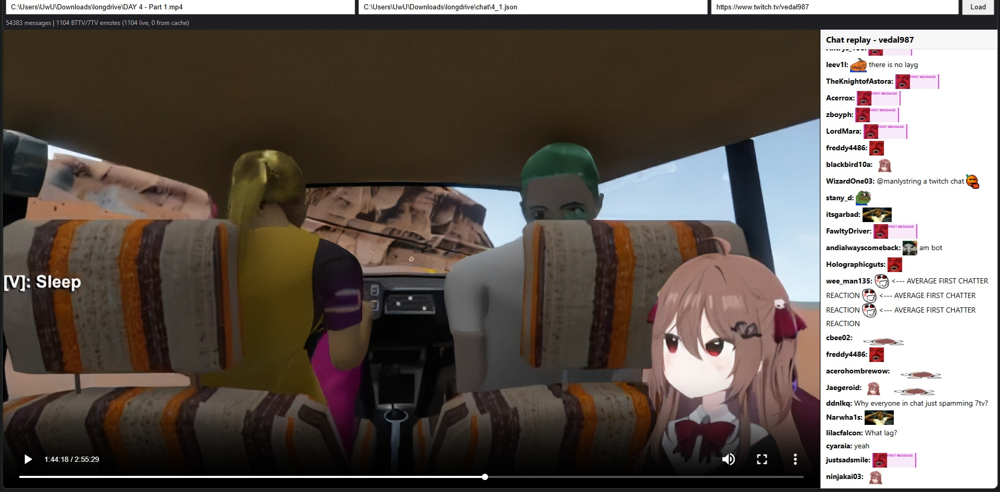

# Render StreamRecorder json 



Renders downloaded Twitch chat json file from [StreamRecorder](https://streamrecorder.io/)

## Quick Start

Download the repo, and run the `run.bat` or open a terminal and do:

```console
$ python serve.py
```

paste the path to the downloaded video, and chat json file, along side the twitch link so it also retrieves the 7tv/bttv emotes.
